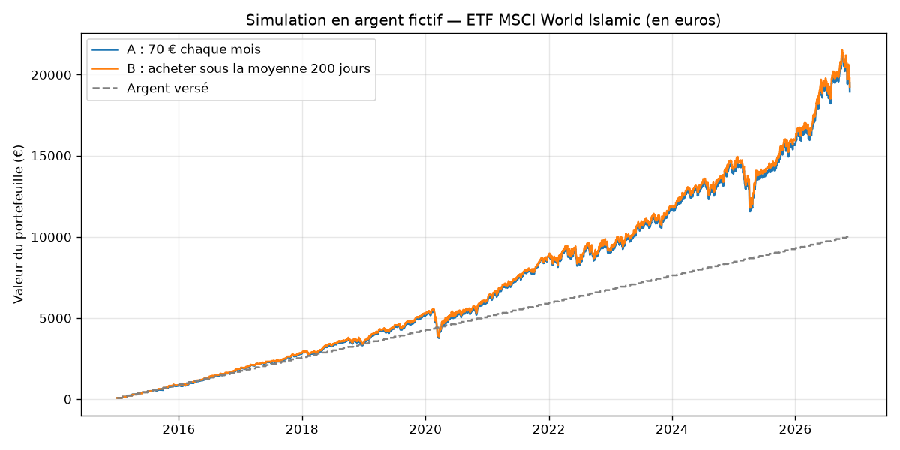

# AgentBourse

Un agent qui investit en bourse, construit pas à pas par un débutant.

> ⚠️ Projet d'apprentissage. Il fonctionne en **argent fictif** (paper trading) par défaut. Ce n'est pas un conseil en investissement.

## Analyseur halal

Tape le nom d'une action, même mal écrit. Le programme propose les actions qui ressemblent, tu choisis, puis il dit à quel point elle est conforme selon 5 normes (stricte, AAOIFI, S&P Shariah, MSCI Islamic, Malaisie), avec une légende et la part de dividende à purifier.

```bash
python -m venv .venv
.venv/Scripts/python -m pip install -r requirements.txt
.venv/Scripts/python analyser.py "apple"
```

Deux vérifications : notre calcul (données gratuites + détecteur d'activités cachées) et l'avis de vrais fonds islamiques (ETF iShares MSCI Islamic, SP Funds S&P 500 Sharia). Troisième vérification, éthique : les listes de l'ONU (rapport A/HRC/59/23 sur l'économie du génocide à Gaza, base de données des entreprises des colonies). **Jamais d'avis positif si l'ONU cite l'entreprise, ni si aucun fonds islamique ne la garde.**

Mesurer nos erreurs face aux fonds islamiques : `.venv/Scripts/python comparer_etf.py` (rapport dans `docs/comparaison-etf.md`).

Tests (sans internet) : `.venv/Scripts/python -m pytest`

> ⚠️ Outil de tri, pas une fatwa. Chiffres de Yahoo Finance, parfois faux ou anciens.

## Simulation en argent fictif

70 € par mois depuis 2015 dans l'ETF iShares MSCI World Islamic, deux stratégies comparées après frais et flat tax :
A (acheter chaque mois) et B (acheter seulement quand le cours passe sous sa moyenne des 200 derniers jours).

```bash
.venv/Scripts/python simuler.py
```


